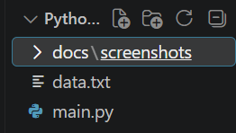
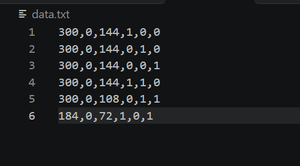
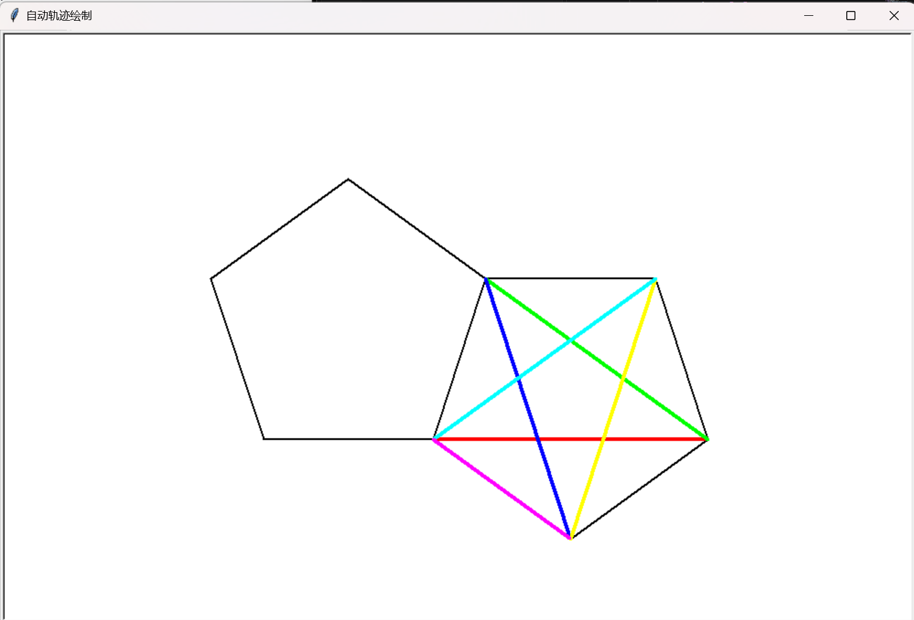

# Python 自动轨迹绘制实验

## 一、项目简介

本项目是基于 Python Turtle 绘图库实现的自动轨迹绘制程序。

程序通过读取外部文本文件中的绘图指令，控制画笔的位置、移动方向、旋转角度和颜色，自动绘制由两个相邻五边形以及多条彩色线段组成的几何图形。

项目采用数据与程序分离的设计方式，通过修改轨迹数据文件，可以调整绘图指令，无需直接修改轨迹计算函数。

## 二、开发环境

| 项目 | 使用环境 |
|---|---|
| 操作系统 | Windows |
| 开发工具 | Visual Studio Code |
| 编程语言 | Python |
| 图形绘制 | turtle |
| 数据读取 | csv |
| 数学计算 | math |
| 文件管理 | pathlib |

本项目使用的均为 Python 标准库，无需额外安装第三方依赖。

## 三、项目主要功能

1. **轨迹数据读取：** 自动读取 `data.txt` 中的六组绘图指令。
2. **坐标计算：** 根据移动距离及转向角度计算轨迹坐标。
3. **颜色控制：** 通过 RGB 参数控制画笔颜色。
4. **多边形绘制：** 绘制两个相邻的黑色五边形轮廓。
5. **彩色轨迹绘制：** 在五边形内部绘制多条不同颜色的线段。
6. **结果展示：** 通过 Turtle 图形窗口展示绘制效果。

## 四、项目目录结构

```text
Python-Auto-Trajectory-Drawing/
├── docs/
│   ├── screenshots/
│   │   ├── 01_project_structure.png
│   │   ├── 02_trajectory_data.png
│   │   └── 03_drawing_result.png
│   └── experiment_report.md
├── main.py
├── data.txt
└── README.md
```

## 五、轨迹数据说明

本次实验使用以下六组数据：

```text
300,0,144,1,0,0
300,0,144,0,1,0
300,0,144,0,0,1
300,0,144,1,1,0
300,0,108,0,1,1
184,0,72,1,0,1
```

按照当前程序的定义，每行包含六个参数：

- 第一个参数：移动距离。
- 第二个参数：转向方向，0 为左转，1 为右转。
- 第三个参数：旋转角度。
- 最后三个参数：RGB 颜色分量，取值范围为 0～1。

程序依次读取这些指令，计算各条轨迹的起点、终点和颜色。

## 六、程序运行方法

### 1. 打开项目

使用 VS Code 打开 `Python-Auto-Trajectory-Drawing` 文件夹。

### 2. 检查轨迹数据

确认 `data.txt` 中存在六条绘图指令。

### 3. 运行程序

在 VS Code 终端执行：

```powershell
python main.py
```

程序运行后会自动弹出 Turtle 绘图窗口，绘制两个相邻的黑色五边形以及彩色轨迹。

终端显示：

```text
轨迹绘制完成！
成功读取 6 条轨迹指令
```

## 七、实验运行效果

### 1. 项目结构



### 2. 轨迹数据



### 3. 自动绘制结果



## 八、程序实现原理

程序首先使用 `csv.reader()` 读取轨迹数据，将每一行转换为数值参数。

接着利用三角函数计算下一位置：

```python
new_x = x + distance * math.cos(math.radians(angle))
new_y = y + distance * math.sin(math.radians(angle))
```

根据转向方向更新角度，并保存轨迹线段信息。

绘制阶段使用 Turtle 绘制黑色多边形轮廓，再根据每条轨迹对应的 RGB 颜色进行彩色线段绘制。

左侧五边形使用几何对称计算得到辅助顶点，从而实现与示例相似的整体布局。

## 九、实验总结

通过本次实验，我学习了 Python Turtle 绘图库的基本使用方法，掌握了文件读取、数据解析、坐标计算以及 RGB 颜色控制等知识。

本次实验将绘图数据与程序逻辑分离，通过读取文本文件自动执行绘图操作，提高了程序的灵活性。

同时，通过实际运行并与课堂示例进行对比，加深了我对程序调试、几何轨迹计算及图形绘制过程的理解。

## 十、实验报告

详细实验步骤与结果分析见：

[查看完整实验报告](docs/experiment_report.md)
