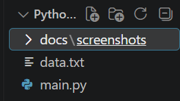
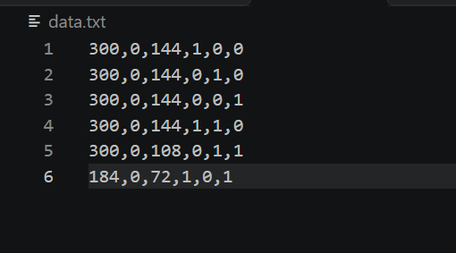
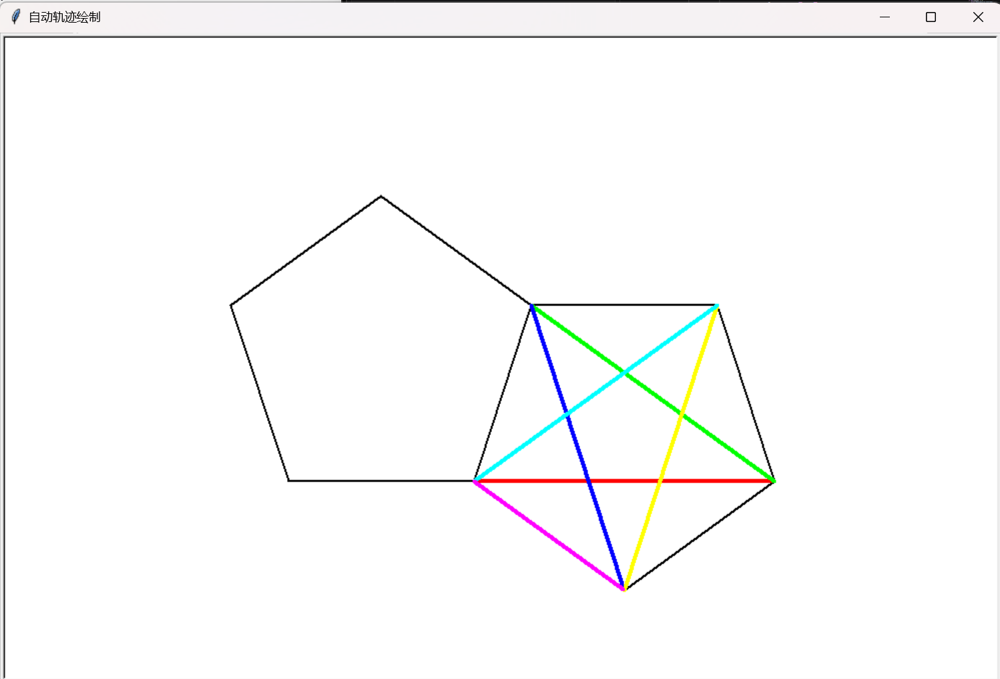

# Python 自动轨迹绘制实验报告

## 一、实验名称

基于 Python Turtle 的自动轨迹绘制实验

## 二、实验目的

1. 掌握 Python Turtle 绘图库的基本使用方法。
2. 学习从文本文件中读取和解析轨迹数据。
3. 理解二维平面中的坐标计算与角度转换方法。
4. 掌握使用 RGB 参数控制绘图颜色的方法。
5. 实现根据外部数据自动绘制几何轨迹。
6. 通过程序运行和图形对比，培养分析问题与调试程序的能力。

## 三、实验环境

| 项目 | 实验环境 |
|---|---|
| 操作系统 | Windows |
| 开发工具 | Visual Studio Code |
| 编程语言 | Python |
| 图形绘制 | turtle |
| 数据读取 | csv |
| 数学计算 | math |
| 文件管理 | pathlib |

本次实验使用 Python 标准库完成，无需安装额外的第三方依赖。

## 四、实验内容

根据课堂展示的自动轨迹绘制示例，编写 Python 程序，读取给定的轨迹数据，并在图形窗口中绘制对应的几何图形。

课堂示例包含两个相邻的五边形，以及多条不同颜色的连接线段。

本次实验采用数据驱动的方式，将绘图指令保存在文本文件中，由程序自动读取并完成轨迹计算与绘制。

## 五、实验原理

### 5.1 Turtle 绘图原理

Turtle 是 Python 内置的图形绘制模块，可以通过控制画笔移动位置、方向和颜色，在二维平面中绘制几何图形。

本次实验主要使用以下操作：

- `turtle.Screen()`：创建绘图窗口。
- `pen.goto()`：将画笔移动到指定坐标。
- `pen.penup()`：抬起画笔，移动时不绘图。
- `pen.pendown()`：落下画笔，移动时绘图。
- `pen.pencolor()`：设置画笔颜色。
- `pen.pensize()`：设置线条宽度。

### 5.2 轨迹数据解析

根据本次程序采用的数据格式，每组绘图指令包含六个参数：

```text
移动距离,转向方向,转动角度,R,G,B
```

其中，转向方向使用 0 和 1 表示，最后三个参数表示 RGB 颜色分量。

需要说明的是，这一格式是本次程序对课堂示例数据采用的解释方式，六列参数的原始定义仍应以老师的完整说明为准。

### 5.3 轨迹坐标计算

假设画笔当前位置为 (x, y)，移动距离为 d，当前方向角为 θ，则下一个位置可由三角函数计算：

```python
new_x = x + distance * math.cos(math.radians(angle))
new_y = y + distance * math.sin(math.radians(angle))
```

其中，`math.radians()` 用于将角度转换为弧度。

每执行一条绘图指令，程序会计算新的坐标，并根据转向参数更新下一次绘图使用的方向角。

### 5.4 RGB 颜色控制

本次实验使用 RGB 三个分量指定线条颜色。

例如：

| RGB 参数 | 对应颜色 |
|---|---|
| (1,0,0) | 红色 |
| (0,1,0) | 绿色 |
| (0,0,1) | 蓝色 |
| (1,1,0) | 黄色 |
| (0,1,1) | 青色 |
| (1,0,1) | 紫色 |

通过不同颜色，可以清楚地区分各条绘图轨迹。

## 六、实验步骤

### 6.1 创建项目

首先在 VS Code 中创建项目文件夹：

`Python-Auto-Trajectory-Drawing`

在项目根目录中创建 `main.py` 和 `data.txt`，分别用于存放绘图程序和轨迹数据。

同时创建 `docs/screenshots` 文件夹，保存实验过程截图。

项目结构如下：

```text
Python-Auto-Trajectory-Drawing/
├── docs/
│   ├── screenshots/
│   │   ├── 01_project_structure.png
│   │   ├── 02_trajectory_data.png
│   │   └── 03_drawing_result.png
│   └── experiment_report.md
├── main.py
├── data.txt
└── README.md
```



### 6.2 准备轨迹数据

根据老师课堂展示的内容，在 `data.txt` 中输入以下六组数据：

```text
300,0,144,1,0,0
300,0,144,0,1,0
300,0,144,0,0,1
300,0,144,1,1,0
300,0,108,0,1,1
184,0,72,1,0,1
```

本次程序通过 CSV 格式读取上述数据，将六个参数分别转换为数值。

通过把数据独立保存在文本文件中，绘图逻辑与输入内容实现了分离。



### 6.3 编写数据读取函数

在 `main.py` 中导入 `csv`、`math`、`turtle` 和 `pathlib` 模块。

编写 `read_data()` 函数，使用 `csv.reader()` 按行读取 `data.txt`。

程序将读取到的每一行数据转换为浮点数，并保存到列表中，作为后续绘图指令。

### 6.4 编写轨迹计算函数

编写 `calculate_track()` 函数。

首先设置画笔初始坐标与方向，然后依次读取每一条轨迹指令。

根据移动距离和当前角度计算线段终点，同时记录：

1. 线段起点。
2. 线段终点。
3. RGB 颜色。

完成当前线段计算后，更新方向角，准备处理下一条绘图指令。

### 6.5 绘制黑色五边形轮廓

使用 `draw_polygon()` 函数连接多边形顶点，绘制右侧五边形轮廓。

为了形成与课堂示例相似的两个相邻五边形，程序使用 `reflect_point()` 函数进行几何对称计算，得到左侧五边形的辅助顶点。

随后连接相关顶点，形成两个相邻的黑色五边形轮廓。

### 6.6 绘制彩色轨迹

完成黑色轮廓后，程序遍历预先计算的轨迹线段。

对于每条线段，先移动到起点，再根据其 RGB 参数设置画笔颜色，最后移动到终点完成绘制。

最终生成红、绿、蓝、黄、青、紫六条彩色线段。

### 6.7 运行程序

在 VS Code 终端执行：

```powershell
python main.py
```

程序自动读取 `data.txt` 中的六条指令，并弹出 Turtle 图形窗口。

实际运行结果显示：

```text
轨迹绘制完成！
成功读取 6 条轨迹指令
```

程序运行过程中没有出现异常报错，绘图窗口成功显示完整的几何图形。

## 七、实验运行结果

本次程序成功绘制出两个相邻的黑色五边形，以及六条不同颜色的内部连接线段。

其中：

- 红色线段沿水平方向连接两个顶点。
- 绿色、蓝色和青色线段形成交叉连接。
- 黄色、紫色线段连接其他顶点。
- 两个五边形保持相邻关系。

实验运行截图如下：



通过对比课堂 PPT，可以看出实际运行的几何结构、线条颜色以及整体布局与示例基本一致。

但由于课堂照片未提供完整的参数定义及计算规则，本次结果主要完成了绘图效果的视觉核对。

## 八、实验结果分析

本次实验成功完成了从数据读取到图形绘制的完整过程。

在数据处理方面，程序能够读取六条绘图指令，并将文本参数转换为可参与计算的数值。

在轨迹计算方面，通过三角函数确定不同线段的坐标，使绘图过程不再依赖手动逐条指定线段终点。

在图形绘制方面，程序通过 Turtle 完成多边形轮廓和多色线段绘制，能够较直观地展示轨迹结果。

此外，程序将数据与绘图代码分离，有利于后续修改和扩展。

本次程序对输入条数进行了简单检查，但尚未实现完整的数据格式、角度范围和颜色参数合法性验证。

## 九、实验中遇到的问题及解决方法

### 9.1 如何根据轨迹参数计算坐标

在实现过程中，需要将移动距离和转向角度转换为具体的坐标变化。

解决方法是使用 `math.cos()` 和 `math.sin()` 计算水平和垂直方向的位移，并通过角度转换函数处理角度单位。

### 9.2 如何绘制不同颜色的轨迹

如果使用统一颜色，绘制的线段不容易区分。

因此，程序根据每条数据对应的 RGB 分量设置画笔颜色，使不同轨迹清楚显示。

### 9.3 如何还原课堂示例中的几何结构

课堂示例不仅包含彩色线段，还包含两个相邻的五边形轮廓。

为获得相似的视觉效果，程序在轨迹计算的基础上增加多边形顶点连接与对称点计算，最终实现完整图形的展示。

## 十、存在的不足与改进方向

虽然本次实验已经实现预期的基本绘图效果，但仍存在一些可以完善的地方。

首先，目前程序主要按照课堂给出的六组数据进行设计，对于更多输入指令还需要增加适配和验证。

其次，程序对数据格式的检查仍比较简单。如果输入数据包含非数字字符、缺失参数或非法颜色值，可能导致运行错误。

最后，当前绘制窗口的尺寸和位置主要采用固定设置，后续可以根据实际图形范围自动调整画布，使图形更适合不同大小的显示窗口。

## 十一、实验收获

通过本次实验，我进一步掌握了 Python Turtle 绘图库的使用方法，了解了如何根据外部数据控制绘图程序自动生成几何图形。

在编写程序的过程中，我学习了利用 CSV 格式读取数据，以及通过三角函数计算二维平面中的轨迹坐标。同时，通过 RGB 参数控制不同线段的颜色，使绘制结果更加清晰。

本次实验也让我认识到，将数据与程序逻辑分离，可以提高程序的灵活性，减少后续修改数据时对源代码的影响。

通过将程序运行结果与课堂示例进行比较，我进一步理解了程序验证和结果分析的重要性。

## 十二、实验总结

本次实验使用 Python 编写自动轨迹绘制程序，通过读取文本文件中的六组轨迹数据，计算线段坐标并利用 Turtle 绘制几何图形。

最终成功展示两个相邻的黑色五边形及六条彩色轨迹，绘图效果与课堂示例基本一致。

通过本次实验，我掌握了 Python 文件读取、数据解析、坐标计算、颜色控制以及 Turtle 绘图的基本方法，完成了本次自动轨迹绘制作业的程序实现与运行验证。